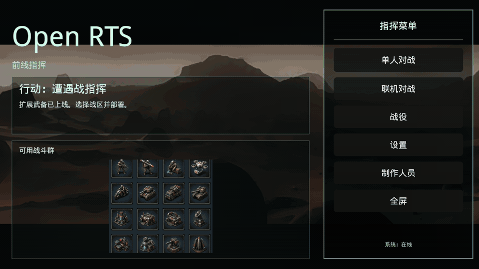

# Bevy Open RTS

A playable 3D real-time strategy game built with Bevy `0.19`: harvest resources,
build a base, field three distinct factions, fight AI skirmishes, or create an
online room and play in the browser through WebGPU. Boot Camp teaches gathering,
construction, production and combat through ordinary controls; the six-mission
campaign records completion separately from resumable match saves.

[](https://xiongchenyu6.github.io/bevy-open-rts/)

**[Play the WebGPU build](https://xiongchenyu6.github.io/bevy-open-rts/)** ·
**[Run natively](#run-native)** · **[Open Bevy online architecture](docs/ONLINE_ARCHITECTURE.md)**

This repository ports `../godot-open-rts` to Bevy. Desktop and browser share
selection, right-click orders, harvesting, construction,
registry-driven production and economy, AI pressure, multiplayer rooms, and a
WebGPU build path all share the same game scene.

The architecture follows the useful lesson from Digital Extinction: keep RTS
behavior separated into ECS systems instead of a single scene script. The root
game package is joined by game-independent Open Bevy protocol and signaling
workspace packages, while RTS systems remain grouped by responsibility.
Playable entity data is generated from
`../godot-open-rts/source/match/MatchConstants.gd` and the Godot unit scenes.

## Run Native

All native commands should run inside the Nix dev shell so Bevy can find the
Wayland/Vulkan/audio runtime libraries:

```sh
direnv allow
cargo run
```

Or run the wrapper directly:

```sh
scripts/run_desktop.sh
```

For desktop packaging and the remaining validation gates, see
[Linux delivery](docs/DESKTOP_DELIVERY.md), [Windows delivery](docs/WINDOWS_DELIVERY.md)
and [release readiness](docs/RELEASE_READINESS.md). Development archives are
verification artifacts; release builds and platform acceptance remain in progress.

## Build WebGPU

Live GitHub Pages build:

https://xiongchenyu6.github.io/bevy-open-rts/

```sh
scripts/build_web.sh
scripts/serve_web.py
```

Then open `http://127.0.0.1:8080`.

The web build requires `wasm-bindgen` on `PATH`. The Nix shell in this repo
includes the wasm target tools. `scripts/build_web.sh` stamps `web/index.html`
with a content hash of the generated JS/WASM artifacts so browsers do not reuse
stale game code after a rebuild.

## Run The Open Bevy Signaling Service

The workspace includes a game-independent Matchbox/WebRTC signaling service.
It provides versioned room creation/discovery, strict room isolation, private
rooms, build compatibility checks, metrics, and short-lived TURN credentials:

```sh
cargo run -p open-bevy-signaling
curl http://127.0.0.1:3536/healthz
```

The native production container/Caddy example lives in `deploy/signaling/`;
both native and Worker targets use Cloudflare Realtime TURN. See
[`docs/ONLINE_ARCHITECTURE.md`](docs/ONLINE_ARCHITECTURE.md) for the API and
networking contract. Other Open Bevy games should start with
[`docs/OPEN_BEVY_GAME_INTEGRATION.md`](docs/OPEN_BEVY_GAME_INTEGRATION.md) and
the compiler-checked `open-bevy-net/examples/universal_room.rs` client. The
current integration milestone is tracked in [`PLAN.md`](PLAN.md).

The native game's **Online** command-menu entry can discover or create public
rooms and join by room code/private token. Hosts configure the map-derived
player slots and launch the same host-authoritative match on every peer.

## Capture And Match Proof

Run `capture boot-camp <dir>` for the seven-step onboarding input test, or
`capture campaign-play <index> <dir>` for authored mission play, victory recording
and the real continuation button. Mission indices are zero-based. Campaign
verification is incomplete; the harness reports failures rather than granting wins.

```sh
cargo run --bin capture -- screenshot screenshots/capture/still.png
cargo run --bin capture -- frames screenshots/result/1 450
cargo run --bin capture -- menu screenshots/menu/menu.png
cargo run --bin capture -- menu-wide screenshots/menu/menu-wide.png
cargo run --bin capture -- menu-return screenshots/menu/menu-return.png
cargo run --bin capture -- menu-options screenshots/menu/options.png
cargo run --bin capture -- menu-credits screenshots/menu/credits.png
cargo run --bin capture -- menu-setup screenshots/menu/setup.png
cargo run --bin capture -- play screenshots/play
cargo run --bin capture -- harvest screenshots/harvest
cargo run --bin capture -- assault screenshots/assault 300
cargo run --bin capture -- match 240
cargo run --bin capture -- factions screenshots/factions
cargo run --bin capture -- model-harness screenshots/model-harness 6
python3 scripts/audit_model_quality.py --fail-critical --require-screenshots
scripts/build_readme_gif.sh
```

`capture menu` renders the Godot-style command menu; `capture menu-wide` renders
the same screen at 2048x1224 to verify desktop proportions. `capture
menu-return` verifies setup -> back leaves a clean command menu. `capture
menu-options`, `capture menu-credits`, and `capture menu-setup` render the
settings, credits, and skirmish setup screens. `capture play` drives the real
input systems through select, move, train, and build actions, then exits
non-zero unless the trained unit actually spawns and a Worker completes the
placed structure. `capture harvest` selects an actual
Worker, right-clicks a visible resource node, and exits non-zero unless a
`HarvestOrder` is issued and player resources grow. `capture assault` uses real
input to build a Barracks, train Heavy Machinegun Troopers, repeatedly
attack-move to living enemy anchors, and exits non-zero unless the player reaches
`HumanVictory`. `capture match` runs a headless AI-vs-AI skirmish and exits
non-zero unless the economy, production, combat, and elimination loop finishes a
match within the given seconds. `capture factions` renders every faction's
starting base and exits non-zero unless each faction can reach human train/build
input through the command panel. `capture model-harness` renders the registry in
isolated model-gallery pages and writes `screenshots/model-harness/manifest.md`;
`scripts/audit_model_quality.py --require-screenshots` verifies that every
registry entity is represented by a non-empty harness page before model quality
work is accepted.

`scripts/build_readme_gif.sh` runs the real capture harness through the menu,
setup, base, harvesting, construction, assault, and victory scenes, then builds
the optimized README loop at `docs/media/bevy-open-rts-gameplay.gif`. Set
`BEVY_OPEN_RTS_REUSE_README_CAPTURES=1` to recompose an existing capture set in
`target/readme-gif` without rerunning gameplay.

## Regenerate Migration Data

```sh
rsync -a --exclude='*.import' ../godot-open-rts/assets/ assets/
scripts/generate_registry.py
cargo fmt
```

Generated outputs:

- `src/generated_registry.rs`: static Rust registry used by the Bevy runtime.
- `assets/migration/gameplay_registry.json`: complete gameplay entity/faction
  audit data.
- `assets/migration/asset_manifest.json`: copied Godot asset inventory.
- `assets/migration/migration_report.md`: human-readable migration summary.

## Current Scope

- Uses Bevy `0.19.0`.
- Registers `bevy_fluent 0.15.0` for future Fluent localization assets while
  preserving the current lightweight `Locale`/`t()` text path during migration.
- Uses `iyes_progress 0.17.0` for the startup loading state, tracking UI,
  cursor, icon, model-map, and migrated GLB assets before entering the command
  menu.
- Uses `moonshine-kind 0.5.1` at the model harness boundary so harness roots are
  typed `Instance<ModelHarnessRoot>` values and registry coverage is backed by a
  harness-owned, compiler-checked ID table.
- Uses `scripts/audit_model_quality.py` as the model quality gate. It verifies
  distinct unit signatures and model-harness screenshot coverage. Ground
  vehicles are drawn procedurally by `src/tank_models.rs`.
- Mirrors the non-`.import` Godot asset tree and generates 73 playable
  unit/structure definitions across the three Godot factions.
- Loads all referenced GLB assets for migrated entities; Godot procedural-only
  render scenes are recreated with Bevy primitive meshes.
- Keeps the browser target on WebGPU through Bevy's `webgpu` feature.
- Leaves the Godot project untouched.

## Controls

- Start with **Boot Camp** for guided play, **Campaign** for missions, or
  **Skirmish** to choose your map, players, factions and difficulty.
- Left-click a visible unit or structure; drag a box to select a group.
- Right-click terrain to move, an enemy to attack, or a deposit to gather.
- Command cards show their current shortcut keys. Hover an icon for its
  action, cost, prerequisites and availability; **Attack-Move** uses the key
  shown on the selected army's card.
- Move the pointer to the viewport edge to pan; the mouse wheel zooms.
- In an offline match, **F5** saves, **F9** loads and **F10** toggles tactical
  pause. Match saves and campaign completion use your per-user data directory.

## Model Harness

```sh
RUST_LOG=warn cargo run --bin capture -- model-harness screenshots/model-harness 6
python3 scripts/audit_model_quality.py --fail-critical --require-screenshots
```

The screenshot directory is ignored by git.
- The OS cursor uses the RTS cursor atlas in `assets/ui/cursors/`: default
  arrow, move/patrol/rally, attack/support targeting, and build/resource
  targeting states.
- Escape opens the in-match menu for resume, restart, or return to setup.
- The bottom command panel changes with the selected producer. Click commands
  to train/build; number keys 1-9 and 0 activate the first ten slots.
